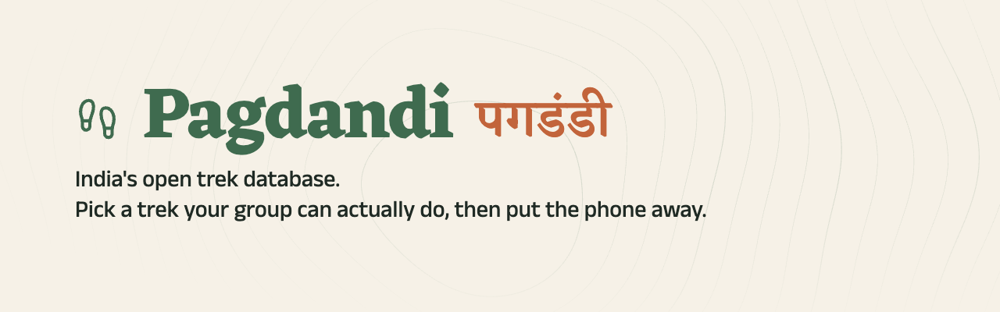
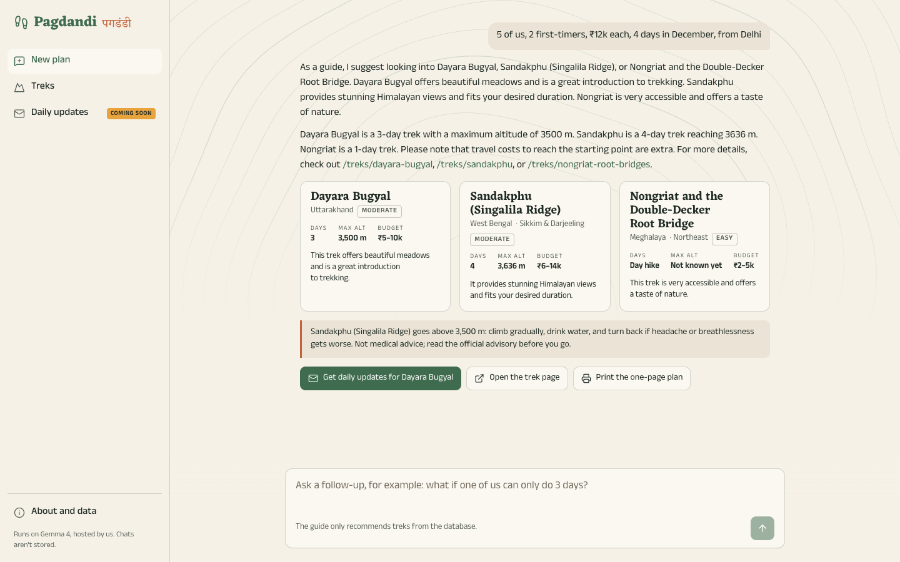
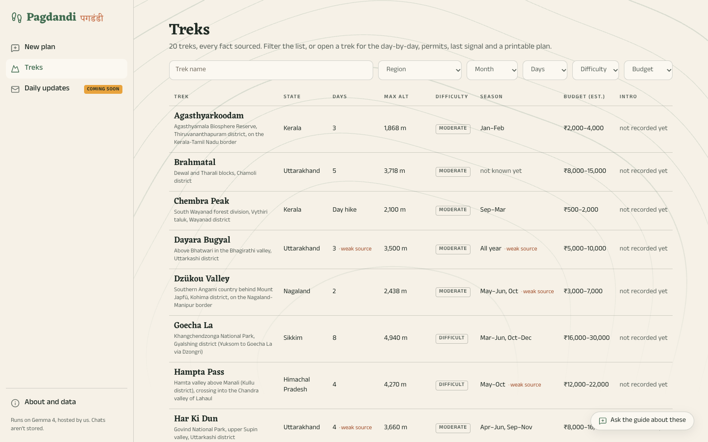

<p align="center"></p>

<p align="center">
  <a href="LICENSE"></a>
  <a href="data/LICENSE.md"></a>
  
  
</p>

Every friend group has a trek it has talked about for years, and a group chat where "this time we're definitely going" never turns into a date. **Pagdandi** (पगडंडी, "footpath") is for that group. Tell it how many of you there are, who has trekked before, the budget, the days, the month and where you're starting from, and it recommends treks you can actually do, from 20 well-known Indian treks with every fact sourced. Then it gets out of the way: an audio intro for the drive, a one-page plan for the trail. It runs on a laptop, model included, and anyone can run their own copy.

## What you get

- **Ask the guide.** "5 of us, 2 first-timers, ₹12k each, 4 days in December, from Delhi." The guide answers in a few sentences, and the cards, nearest first, come from the database. Treks above 3,500 m come with an altitude note.

  

- **A trek database with sourced facts.** All 20 treks in one table, with plain filters. Every fact names its source, a missing fact says "not known yet", and a fact whose only source is weak is marked.

  

- **Audio intros and a one-page plan.** Each trek page has a short audio intro to download for the drive, and prints on one page: the day-by-day, permits, last mobile signal and an altitude figure.
- **Daily updates** (admin-only for now). One email at 7:00 IST until you leave: the forecast at the road head and the high point, this week's news, and one thing to do outside today. Until Pagdandi has a domain, only the admin gets them.

## How it works

The guide is Gemma 4 (`gemma4:e4b`) and search runs on EmbeddingGemma, both through Ollama on the laptop that serves the site: no server, and no per-chat bill. A Mastra agent with four read-only tools searches Postgres (Tiger Data or a local one) using hybrid search: full-text `tsvector` plus pgvector embeddings, fused with reciprocal rank fusion. Recommendations come back as cards rendered from the database, and plain code checks every altitude, distance, day count and cost in the guide's sentences before you see them. A daily job fetches each followed trek's forecast from Open-Meteo and news through SerpApi (under hard caps), and Gemma summarises the news. ElevenLabs voiced each trek's audio intro once, from its sourced script.

## Run it

On macOS with Homebrew (or the same tools on Linux):

```sh
brew install ollama postgresql@17 pgvector node@24 pnpm
pnpm install
cp .env.example .env            # set ADMIN_EMAIL; everything else has a working default
pnpm dev:up                     # starts Postgres (127.0.0.1:54329) and Ollama if they aren't running
ollama pull gemma4:e4b && ollama pull embeddinggemma:300m
pnpm treks:load && pnpm treks:embed
pnpm dev                        # http://localhost:3000
```

| Variable | What it unlocks |
|---|---|
| `DATABASE_URL` | Postgres. The default is the one `pnpm dev:up` starts; a Tiger Data service URL (with `sslmode=require`) works too. |
| `ADMIN_EMAIL` | Required. The only address daily emails ever go to. |
| `NEWS_MODE=serpapi`, `SERPAPI_API_KEY` | Live news in the daily email. Without them, recorded samples, labelled as samples. |
| `EMAIL_MODE=smtp`, `SMTP_HOST`, `SMTP_USER`, `SMTP_PASS` | Sends the daily email from your own mailbox (`SMTP_PORT` 587 with STARTTLS, or 465). Without them, emails are written to `.data/outbox/`. For Gmail, use an app password; any SMTP mailbox works. |
| `ELEVENLABS_API_KEY`, `ELEVENLABS_VOICE_ID` | `pnpm audio` only, to generate the intros. |

- **Daily updates:** `pnpm digest` sends today's emails. To run it at 7:00 IST from the laptop, add a cron line (with the laptop's clock on IST and `pnpm` on cron's `PATH`): `0 7 * * * cd /path/to/pagdandi && pnpm digest >> .data/digest.log 2>&1`. A launchd job works too.
- **Audio:** `pnpm audio --estimate` lists the intros that are missing or whose script changed, and `pnpm audio` makes them. See [CONTRIBUTING](CONTRIBUTING.md#audio-intros).

`pnpm dev:down` stops only what `pnpm dev:up` started.

## Data

Each trek is a YAML file in `data/treks/`, written from open sources only: Wikipedia, Wikivoyage, OpenStreetMap, UNESCO and government pages, never trekking companies. Every fact that isn't `null` names the source that backs it, and the schema rejects anything else. If a fact can't be sourced it stays `null`, and the site says "not known yet". We never guess an altitude. A fact whose only source is weak carries a `weak_sources` note that the site shows. Difficulty and budget are our own estimates, made with fixed rules and labelled as such. The data is CC BY-SA 4.0. Fix a trek or add one by pull request: see [CONTRIBUTING](CONTRIBUTING.md).

## Privacy and safety

- Chats go to the model on the laptop serving the site, not to a model company. The page holds the conversation in memory only, and nothing is logged.
- The guide's prompt is fixed on the server, its four tools only read the database, and chats are capped (6 a minute, 500 characters, the last 8 turns, 5 steps, 450 output tokens).
- Cards come from the database, and plain code checks every number in the guide's sentences; anything that doesn't match becomes "(see the card)". A sentence that copies eight or more words in a row from the guide's instructions is replaced with a fixed reply.
- A red-team suite ([`tests/integration/red-team.test.ts`](tests/integration/red-team.test.ts)) runs real Gemma against off-topic requests, prompt injection, requests for its prompt, treks and altitudes we don't have, a Hinglish group, and HTML in the message.
- Ollama must be on this machine unless `OLLAMA_ALLOW_REMOTE=true`, and the rate limit ignores `X-Forwarded-For` unless `TRUST_PROXY=true`.
- Daily emails go only to the admin, over SMTP from the admin's own mailbox. We store the email, the trek and the travel date, delete them the day after travel, and keep tokens only as hashes.
- Hosted services see some data: SerpApi trek names, ElevenLabs the audio scripts, Open-Meteo trek coordinates, and Tiger Data, if it hosts the database, the guide's search queries and the admin's subscription.
- Not medical advice, and not a substitute for a licensed local guide.

## Built for

The [DEV Hacktoberfest Open-Source AI Challenge, Week 1: Touch Grass](https://dev.to/challenges/hacktoberfest-week1-2026-10-05). Submission post: *link added when published*.

| Category | How Pagdandi uses it |
|---|---|
| Gemma | Gemma 4 runs the guide and summarises news; EmbeddingGemma powers search. Both run through Ollama on the laptop. |
| Tiger Data | Postgres with pgvector: the treks, the hybrid search index, conditions, subscriptions and API budget counters. |
| SerpApi | Google News results for each followed trek (closures, landslides, snowfall, permits), behind per-day and per-month caps. |
| ElevenLabs | A short audio intro for every trek, generated once from its sourced script and committed as an MP3. |
| Mastra | The agent framework behind the guide: the agent, its read-only tools and the streaming chat. |

## Testing

`pnpm test` runs the unit tests, with no services: schema and sourcing, the fact-check, search ranking, pages, email, audio, the digest, env validation and lockfile hosts.

`pnpm test:integration` runs after `pnpm dev:up`, against real Postgres and Gemma: hybrid search, the guide's recommendations, the red-team suite and the digest dry run. CI runs both.

## License and attribution

- Code: [MIT](LICENSE). Trek data: [CC BY-SA 4.0](data/LICENSE.md).
- Map data: © [OpenStreetMap contributors](https://www.openstreetmap.org/copyright), ODbL. Forecasts: [Weather data by Open-Meteo.com](https://open-meteo.com/), CC BY 4.0.
- Gemma 4: [Apache 2.0](https://ai.google.dev/gemma/apache_2). EmbeddingGemma is provided under and subject to the [Gemma Terms of Use](https://ai.google.dev/gemma/terms), and the site's terms carry the [Prohibited Use Policy](https://ai.google.dev/gemma/prohibited_use_policy).
- Audio: generated with [ElevenLabs](https://elevenlabs.io) from each trek's sourced facts; the scripts are the `audio_script` field in each trek's YAML. Voice: George - Warm, Captivating Storyteller, an ElevenLabs default voice (`eleven_multilingual_v2`).
- Logo: the Lucide "footprints" icon, ISC ([notice](public/brand/logo-LICENSE.txt)). Fonts: Eczar and Anek Devanagari (SIL Open Font License), self-hosted at build time.

## After the deadline

The challenge closed on Mon 12 Oct 2026 at 06:59 UTC. Commits made after that are listed here, with dates.

*None yet.*
